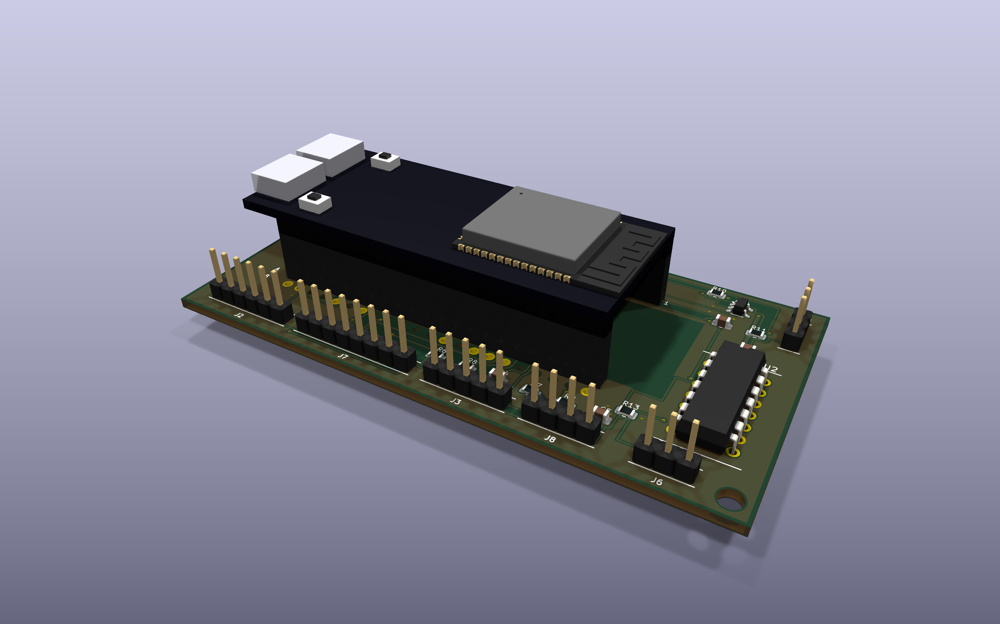
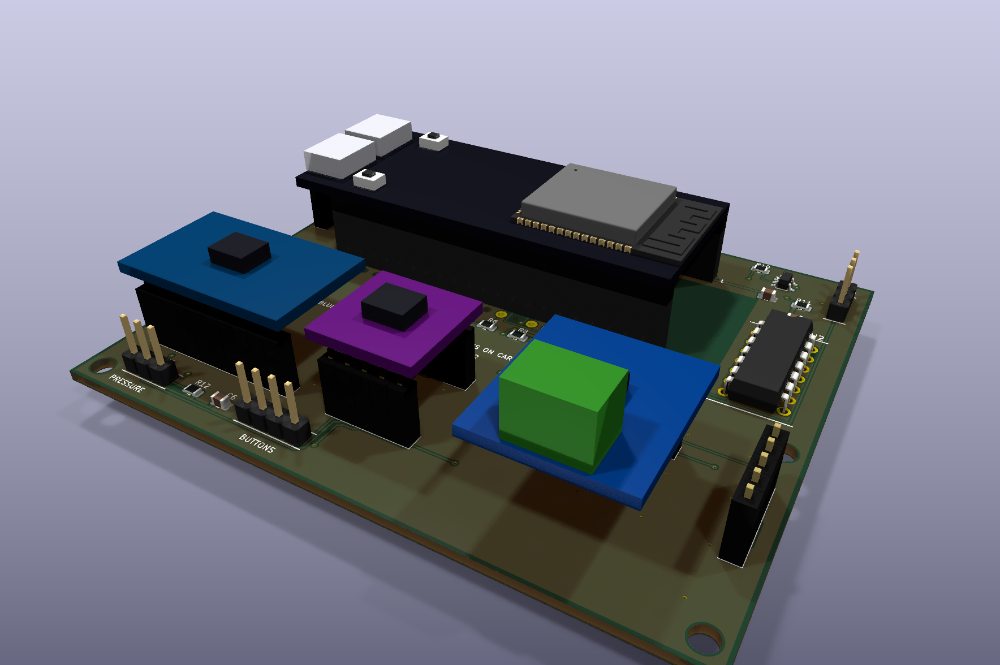
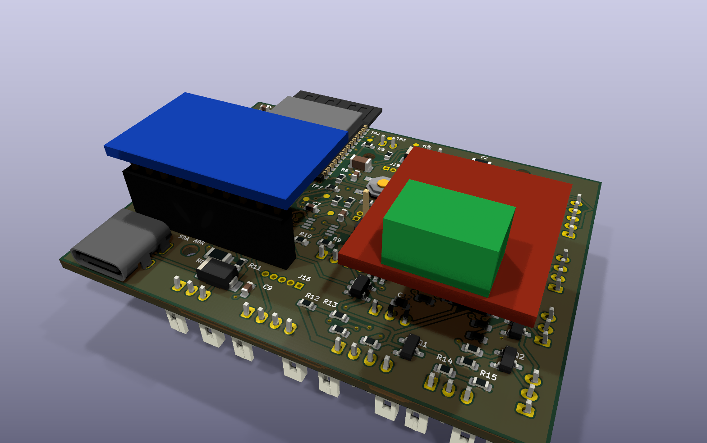

# GemilaiMate

**Gemilai 3007Z · carrier v0.1 / shield v0.2.4 / Compact 0.3.1 · firmware v0.1.0 · Rico-X**

> **Проект пока не воспроизводился в железе. Ни одна плата не изготовлена и не собрана, USB-прошивка на реальных модулях и работа в кофемашине не проверялись. Успешные сборки, тесты и ERC/DRC относятся только к файлам и программным моделям.**

Самостоятельный проект адаптации управления проливом Gemilai 3007Z: ESP32-S3, LilyGo T-RGB 2.1, давление через ADS1115, термопара MAX31855, управление помпой через RobotDyn и клапаном через внешний SSR. Предполагается сохранение штатного управления нагревом и паром; применимость к конкретной машине ещё требует проверки. Сеть 230 В ни на одну из плат не заходит.

**Сайт проекта: [rico-x.github.io/GemilaiMate](https://rico-x.github.io/GemilaiMate/)** — все платы, схемы подключения с 3D, закупка и пошаговый монтаж Compact.

Разводка, исходники и производственные файлы находятся в этом репозитории; исходный проект не требуется для сборки. Обновления извне автоматически не подтягиваются, нужные изменения переносятся вручную после проверки.

## Три варианта платы

Варианты независимы: у каждого свой KiCad-проект и производственный комплект. GPIO и логика прошивки общие, отличаются компоновка, контроллер и способ сборки.

| | [Carrier v0.1](#carrier-v01) | [Shield v0.2.4](#shield-v024) | [Compact 0.3.1](#compact-031) |
|---|---|---|---|
| Текстолит | 90×46 мм, 2 слоя | 90×75 мм, 2 слоя | 76×61 мм, 2 слоя + антенна 7 мм |
| Контроллер | ESP32-S3 DevKit N8R8 в гнёздах | ESP32-S3 DevKit N8R8 в гнёздах | ESP32-S3-WROOM-1-N16R8 на плате |
| ADS1115 / MAX31855 / TXS0102 | на жгутах | в гнёздах | в гнёздах |
| Жгуты базовой машины | 9 жгутов, 37 проводов | 6 жгутов, 18 проводов | 6 жгутов, 18 проводов |
| SMD | 20 | 20 | 77, в том числе WROOM и USB-C |
| Цель прошивки | `controller`, ID=3 | `controller`, ID=3 | `controller-compact`, ID=4 |
| Подключение и 3D | [wiring.html](https://rico-x.github.io/GemilaiMate/wiring.html) | [shield-wiring.html](https://rico-x.github.io/GemilaiMate/shield-wiring.html) | [compact-wiring.html](https://rico-x.github.io/GemilaiMate/compact-wiring.html) |

## Carrier v0.1

Исходная плата 90×46 мм: DevKit в гнёздах, измерительные и силовые модули подключаются жгутами. Плата не изменялась с первого выпуска.

- [Подключение в машине: схема, 3D и жгуты](https://rico-x.github.io/GemilaiMate/wiring.html) ([файл](docs/wiring.html)).
- [Сборка и крепление](docs/assembly.md), [интерфейсы платы](docs/interfaces.md), [корпуса жгутов](docs/harnesses.md).
- [Комплектующие](docs/components.md) и [пример закупки комплекта](docs/purchase-kit.md).
- KiCad: [`hardware/carrier/gemilaimate-carrier.kicad_pro`](hardware/carrier/gemilaimate-carrier.kicad_pro). Производство: [Gerber/Excellon, BOM, CPL](hardware/carrier/manufacturing/). Шаблон: [`mounting-template-1to1.pdf`](hardware/carrier/mounting-template-1to1.pdf).

Жгуты J5/J6 собирать в цельных маркированных корпусах по [таблице](docs/harnesses.md): у carrier J5 — 1×4, J6 — 1×3, гнездовые контакты. Корпуса без механического ключа: разворот на 180° возможен, перед питанием нужна проверка ориентации и прозвонка. Перед изготовлением сверить реальный ESP32 с шаблоном и просвет ≥5 мм под ним.

## Shield v0.2.4

Плата 90×75 мм: в неё напрямую вставляются DevKit, ADS1115, TXS0102 и MAX31855 — вместо трёх жгутов. RobotDyn и SSR закрепляются отдельно и подключаются управляющими жгутами 4+3 жилы; прямая стыковка силовых модулей не предусмотрена. Shield не заменяет carrier.

- [Рендеры, маркировка, шаблон 1:1 и распиновка](https://rico-x.github.io/GemilaiMate/shield.html) ([файл](docs/shield.html)).
- [Подключение shield: схема, 3D и жгуты](https://rico-x.github.io/GemilaiMate/shield-wiring.html) ([файл](docs/shield-wiring.html)).
- [Сборка, ориентация и ограничения](docs/shield.md), [держатель с прижимами](docs/retention.md) (ещё не изготовлен и не примерен).
- KiCad: [`hardware/shield/gemilaimate-shield.kicad_pro`](hardware/shield/gemilaimate-shield.kicad_pro). Производство: [Gerber ZIP, BOM, CPL](hardware/shield/manufacturing/). Шаблон: [`mounting-template-1to1.svg`](hardware/shield/mounting-template-1to1.svg).

Ориентация гнёзд отмечена на PCB. Ответные колодки и крепёж проверены только по номинальным допускам. У shield и carrier разные пол контактов и корпус J6 — таблицы жгутов не взаимозаменяемы.

## Compact 0.3.1

Самая маленькая плата: 76×61 мм, два слоя. ESP32-S3-WROOM-1-N16R8 и собственный USB-C (только для прошивки) распаяны на плате; ADS1115, MAX31855 и CJMCU-0102 вставляются в гнёзда сверху, все кабельные JST PH/XH — снизу. Посадочные места рассчитаны на ручную пайку: 0805/1206, SOT-23, SOIC. Определение платы соответствует GaggiMate Pro PCB Rev 1.1 (ID=4). ERC/DRC и воспроизводимая пересборка пройдены; переключение официальной и собственной прошивки не испытывалось.

- [Обзор: рендеры, сборочные виды, распиновка разъёмов](https://rico-x.github.io/GemilaiMate/compact.html) ([файл](docs/compact.html)).
- [Подключение: схема, 3D и жгуты](https://rico-x.github.io/GemilaiMate/compact-wiring.html) ([файл](docs/compact-wiring.html)).
- [Gemilai 3007Z: гидравлика с двумя трёхходовыми клапанами и подключение Compact](https://gemilaimate-3007z-wiring.wiseparrot.chatgpt.site/) (закрытая страница Sites, [копия HTML в репозитории](docs/gemilai-3007z-hydraulics.html)).
- [Закупка с расчётом количества](https://rico-x.github.io/GemilaiMate/compact-purchase.html) ([файл](docs/compact-purchase.html)) и [что докупить к прежнему комплекту](docs/compact-purchase-delta.md).
- [Пошаговый монтаж с картами позиций](https://rico-x.github.io/GemilaiMate/compact-assembly.html) ([текстовая версия](docs/compact-assembly.md)).
- [Описание, допуски, питание, GPIO и приёмка](docs/compact-shield.md), [требования](docs/plans/compact-shield.md), [размеры компонентов](docs/component-dimensions.md).
- KiCad: [`hardware/shield-compact/gemilaimate-compact.kicad_pro`](hardware/shield-compact/gemilaimate-compact.kicad_pro). Производство: [Gerber ZIP, BOM, CPL, жгуты](hardware/shield-compact/manufacturing/). Печать 1:1: [сверху](hardware/shield-compact/previews/assembly-1to1.pdf), [снизу](hardware/shield-compact/previews/assembly-bottom-1to1.pdf).

Прошивка — цель `controller-compact` из текущих исходников; старый релиз v0.1.0 её не содержит. Самые трудные места ручной сборки — центральная земля WROOM и USB-C с шагом 0,5 мм. Реальные модули-клоны не замерены: до заказа приложить их к печати 1:1.

## Начать здесь

1. [Статус проверок и открытые вопросы](docs/validation.md), [совместимость](docs/compatibility.md).
2. Выбрать плату и пройти её раздел выше: подключение, закупка, сборка.
3. [Низковольтный стенд](docs/bench.md) и [прошивка через USB](docs/flashing.md) — до установки в машину.
4. [Производство и бюджет](docs/manufacturing.md).
5. [Сборка исходников и сопровождение](docs/development.md).

Общая прошивка carrier и shield: [релиз v0.1.0](https://github.com/Rico-X/GemilaiMate/releases/tag/v0.1.0). Сетевое OTA отключено; устанавливать согласованную пару controller/display через USB.

| Путь | Содержание |
|---|---|
| `firmware/` | Код контроллера, дисплея, веб-интерфейса, протокол и текущие тесты |
| `hardware/carrier/` | Carrier v0.1 90×46 с жгутами; исходная плата без изменений |
| `hardware/shield/` | Shield v0.2.4 90×75 с модульными гнёздами; отдельные KiCad, Gerber/BOM, SVG 1:1 |
| `hardware/shield-compact/` | Compact 0.3.1: KiCad, схема, проверки, рендеры и опытный производственный комплект; N16R8, без DevKit |
| `tools/` | Сборка релиза, генераторы страниц, проверки, host-тесты и проверяющий прошивальщик |
| `docs/` | Документация текущей версии и страницы GitHub Pages |

Адаптация под Gemilai, платы и сопровождение: **Rico-X**. Код основан на GaggiMate авторства jniebuhr и участников проекта; изменения и лицензии указаны в [NOTICE](NOTICE.md) и [LICENSE](LICENSE.md). Это независимая адаптация, без заявления о проверенной совместимости или одобрении исходными авторами.
