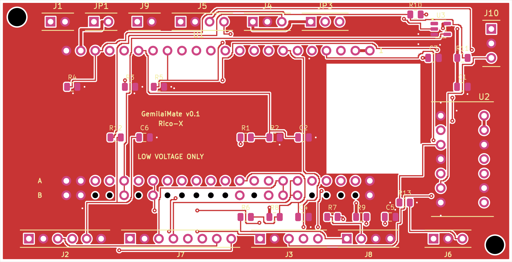
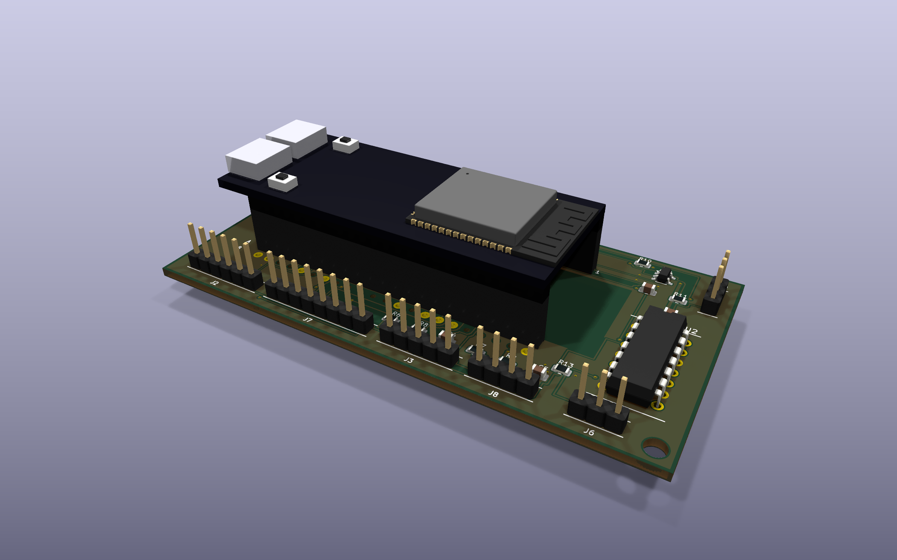

# GemilaiMate

**Gemilai 3007Z · carrier v0.1 · firmware v0.1.0 · Rico-X**

> **Проект пока не воспроизводился в железе. Плата не изготовлена и не собрана, USB-прошивка на реальных модулях и работа в кофемашине не проверялись. Успешные сборки, тесты и ERC/DRC относятся только к файлам и программным моделям.**

Самостоятельный проект адаптации управления проливом Gemilai 3007Z: ESP32-S3 N8R8, LilyGo T-RGB 2.1, давление через ADS1115, термопара MAX31855, управление помпой через RobotDyn и клапаном через внешний SSR. Предполагается сохранение штатного управления нагревом и паром; применимость к конкретной машине ещё требует проверки.

Carrier содержит только низковольтные цепи, 90×46 мм, два слоя. Внешние модули соединяются жгутами. Разводка, исходники и производственные файлы находятся в этом репозитории; исходный проект не требуется для сборки. Обновления извне автоматически не подтягиваются, нужные изменения переносятся вручную после проверки.

## Начать здесь

1. [Статус проверок и открытые вопросы](docs/validation.md).
2. [Комплектующие](docs/components.md), [сборка и крепление](docs/assembly.md), [интерфейсы платы](docs/interfaces.md).
3. [Низковольтный стенд](docs/bench.md) и [прошивка через USB](docs/flashing.md).
4. [Производство и бюджет](docs/manufacturing.md).
5. [Сборка исходников и сопровождение](docs/development.md).

Текущие артефакты: [релиз v0.1.0](https://github.com/Rico-X/GemilaiMate/releases/tag/v0.1.0). Репозиторий закрытый, для загрузки нужен доступ к нему. Сетевое OTA отключено; устанавливать согласованную пару controller/display через USB.

| Путь | Содержание |
|---|---|
| `firmware/` | Код контроллера, дисплея, веб-интерфейса, протокол и текущие тесты |
| `hardware/carrier/` | KiCad 10, локальные библиотеки, 1:1 PDF, схема, текущие отчёты |
| `hardware/carrier/manufacturing/` | Gerber/Excellon ZIP, BOM-SMD, BOM-THT и CPL |
| `tools/` | Сборка релиза, host-тесты и проверяющий прошивальщик |
| `docs/` | Только документация текущей версии |

Открывать в KiCad: [`hardware/carrier/gemilaimate-carrier.kicad_pro`](hardware/carrier/gemilaimate-carrier.kicad_pro). Шаблон: [`mounting-template-1to1.pdf`](hardware/carrier/mounting-template-1to1.pdf). Перед изготовлением сверить реальный ESP32 с шаблоном и просвет ≥5 мм под ним.

Адаптация под Gemilai, carrier и сопровождение: **Rico-X**. Код основан на GaggiMate авторства jniebuhr и участников проекта; изменения и лицензии указаны в [NOTICE](NOTICE.md) и [LICENSE](LICENSE.md). Это независимая адаптация, без заявления о проверенной совместимости или одобрении исходными авторами.
