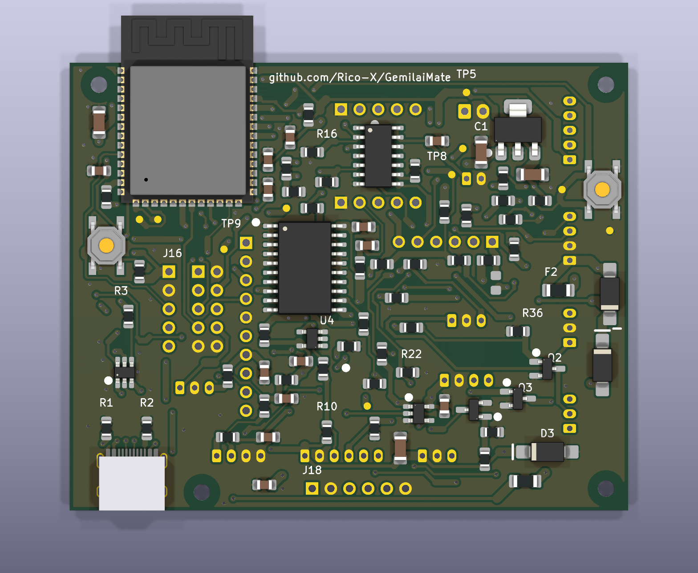

# Пошаговый монтаж Compact Shield 0.3.1

**Плата в железе ещё не собиралась.** Порядок рассчитан на ручную пайку: сначала все SMD сверху, затем гнёзда модулей и кабельные разъёмы, модули — последними. Интерактивная версия с картами позиций и отметками: [https://rico-x.github.io/GemilaiMate/compact-assembly.html](https://rico-x.github.io/GemilaiMate/compact-assembly.html).

Печать 1:1: [сверху](../hardware/shield-compact/previews/assembly-1to1.pdf), [снизу](../hardware/shield-compact/previews/assembly-bottom-1to1.pdf). Закупка: [https://rico-x.github.io/GemilaiMate/compact-purchase.html](https://rico-x.github.io/GemilaiMate/compact-purchase.html), [разница с прежним комплектом](compact-purchase-delta.md). Ограничения платы: [Compact Shield](compact-shield.md).

## 1. Подготовка и проверка голой платы

**Инструмент:** паяльник с регулировкой и жалами 1–2 мм, флюс-гель без отмывки, припой Ø0,5 мм, пинцет, оплётка, лупа или микроскоп, мультиметр, лабораторный БП 5 В с ограничением тока, изопропиловый спирт и щётка. Для центральной земли WROOM — нижний подогрев или фен.

Распечатать [сборочный вид 1:1](../hardware/shield-compact/previews/assembly-1to1.pdf) при 100% и положить рядом: подписи мелких деталей на шелкографию не поместились.

Детали держать в подписанных пакетах по одному номиналу; доставать только ту ленту, что паяется сейчас.

**Проверка:**

- [ ] Плата без сколов, перемычек и непротравов; маска цела у USB-C и WROOM.
- [ ] Прозвонка: J4 контакт 1 (квадратная площадка, +5 В) — GND, и TP5 (+3,3 В) — TP6 (GND) — не короткое замыкание.
- [ ] Реальные ADS1115, MAX31855, CJMCU-0102 и JST приложены к печати 1:1 — контуры и шаг совпадают.

## 2. Питание: предохранители, диоды, стабилизатор

Первым паяется узел питания, чтобы проверить 3,3 В до установки дорогого модуля.

F1 — 0,5 А (USB), F2 — 1,5 А (вход 5 В): не перепутать, корпуса одинаковые.

D1/D2 SS14 и D3 SMAJ5.0A — полоса катода к черте на шелкографии. U3 — широкий таб к контуру таба.

| Позиции | Номинал | Корпус | Ориентация | Шт. |
|---|---|---|---|---:|
| F1 | 1206L050YR 0.5A | 1206 | любая | 1 |
| F2 | 1206L150/12 1.5A | 1206 | любая | 1 |
| D1 D2 | SS14 | SMA | полоса катода к черте шелкографии | 2 |
| D3 | SMAJ5.0A | SMA | полоса катода к черте шелкографии | 1 |
| U3 | AP7361C-33E-13 | SOT-223 | широкий таб — к контуру таба | 1 |
| C1 C2 C16 | 10uF 16V X7R | 1206 | любая | 3 |

**Проверка:**

- [ ] Подать 5 В от БП с ограничением 50–100 мА щупами на площадки J4: квадратная — «+», вторая — GND.
- [ ] TP5 относительно TP6: 3,3 В ±3%. Ток — единицы миллиампер; упор в ограничение — искать замыкание.
- [ ] Снять питание, разрядить конденсаторы.

## 3. ESP32-S3-WROOM, запуск и кнопки

U1 кладётся антенной наружу за верхний край; метка вывода 1 модуля — к метке шелкографии. Модуль выровнять по всем трём сторонам площадок до пайки.

Центральную землю паять нижним подогревом или феном с тонким слоем пасты; боковые выводы — паяльником с флюсом. Один паяльник не гарантирует пайку скрытого контакта — это слабое место сборки.

Затем C3, C4, C5, R5 (EN), R6 (BOOT) и кнопки SW1 RESET, SW2 BOOT.

| Позиции | Номинал | Корпус | Ориентация | Шт. |
|---|---|---|---|---:|
| U1 | ESP32-S3-WROOM-1-N16R8 | модуль 18×25,5 | антенна наружу за верхний край | 1 |
| C3 | 10uF 16V X7R | 1206 | любая | 1 |
| C4 | 100nF 50V X7R | 0805 | любая | 1 |
| C5 | 1uF 16V X7R | 0805 | любая | 1 |
| R5 R6 | 10k 1% | 0805 | любая | 2 |
| SW1 | RESET | TL3342 SMD | по площадкам; прозвонить после пайки | 1 |
| SW2 | BOOT | TL3342 SMD | по площадкам; прозвонить после пайки | 1 |

**Проверка:**

- [ ] Под лупой: нет перемычек между выводами WROOM, все галтели смочены.
- [ ] Кнопки: в покое разомкнуты, при нажатии замкнуты (прозвонка по площадкам).
- [ ] Нет КЗ +3,3 В — GND (TP5–TP6).

## 4. USB-C и защита

J1 HRO TYPE-C-31-M-12: направляющие штырьки корпуса — в отверстия, разъём к нижнему краю. Сначала пропаять крепёжные лепестки, затем контакты с обильным флюсом протяжкой; перемычки снять оплёткой.

U2 USBLC6-2SC6 — вывод 1 к точке. R1/R2 5,1 кОм (CC), R3/R4 22 Ом (D+/D−).

| Позиции | Номинал | Корпус | Ориентация | Шт. |
|---|---|---|---|---:|
| J1 | TYPE-C-31-M-12 | USB-C 16P SMD | штырьки корпуса в отверстия, разъём к нижнему краю | 1 |
| U2 | USBLC6-2SC6 | SOT-23-6 | вывод 1 к точке шелкографии | 1 |
| R1 R2 | 5.1k 1% | 0805 | любая | 2 |
| R3 R4 | 22R 1% | 0805 | любая | 2 |

**Проверка:**

- [ ] VBUS — GND, D+ — D−, D± — GND не замкнуты.
- [ ] USB к компьютеру (без J4): удерживая BOOT, нажать и отпустить RESET, отпустить BOOT — появляется устройство Espressif USB JTAG/serial.
- [ ] `python -m esptool --port ПОРТ flash_id` показывает ESP32-S3 и размер Flash 16MB.

## 5. ID платы и вход давления

R7 10 кОм и **R8 1,58 кОм** задают ID=4: по нему оригинальная прошивка выбирает профиль платы. C6 10 нФ — C0G.

R9 1 кОм и C9 100 нФ — RC-фильтр давления на A0 ADS1115.

| Позиции | Номинал | Корпус | Ориентация | Шт. |
|---|---|---|---|---:|
| R7 | 10k 1% | 0805 | любая | 1 |
| R8 | 1.58k 1% | 0805 | любая | 1 |
| C6 | 10nF 50V C0G | 0805 | любая | 1 |
| R9 | 1k 1% | 0805 | любая | 1 |
| C9 | 100nF 50V X7R | 0805 | любая; под ADS1115 | 1 |

**Проверка:**

- [ ] R8 измерен до пайки: 1,56–1,60 кОм.

## 6. Микросхемы и транзисторы

Все корпуса — вывод 1 к точке шелкографии. Для SOIC сначала прихватить один угловой вывод, выровнять, затем противоположный угол и остальные.

U4 (SN74LVC1G17) и U5 (SN74LVC1G125) — одинаковые SOT-23-5 с разной функцией: брать из разных пакетов. Q1 MMBT3904 и Q2/Q3 AO3400A — тоже одинаковые SOT-23.

U6 стоит под CJMCU-0102, U7 — под ADS1115: после установки гнёзд к ним не подобраться.

| Позиции | Номинал | Корпус | Ориентация | Шт. |
|---|---|---|---|---:|
| U4 | SN74LVC1G17DBVR | SOT-23-5 | вывод 1 к точке шелкографии; под ADS1115 | 1 |
| U5 | SN74LVC1G125DBVR | SOT-23-5 | вывод 1 к точке шелкографии | 1 |
| U6 | SN74AHCT125DR | SOIC-14 3,9 мм | вывод 1 к точке шелкографии; под CJMCU-0102 | 1 |
| U7 | PCA9634D | SOIC-20W 7,5 мм | вывод 1 к точке шелкографии; под ADS1115 | 1 |
| Q1 | MMBT3904 | SOT-23 | вывод 1 к точке шелкографии | 1 |
| Q2 Q3 | AO3400A | SOT-23 | вывод 1 к точке шелкографии | 2 |

**Проверка:**

- [ ] Под лупой нет перемычек на SOIC; все выводы в припое.
- [ ] Каждая микросхема — своей маркировкой и ориентацией.

## 7. Остальные резисторы и конденсаторы

Паять по одному номиналу за раз, сверяясь с таблицей и печатью 1:1; ориентация не важна.

R27, R28, R41 — перемычки 0 Ом. R27/R28 не ставить, если подключается внешняя Alba со своим PCA9634. R42 не устанавливать (вариант питания MAX31855 от 5 В).

Часть деталей уходит под модули — пропуск обнаружится только после снятия гнёзд.

| Позиции | Номинал | Корпус | Ориентация | Шт. |
|---|---|---|---|---:|
| R27 R28 R41 | 0R | 0805 | любая; под MAX31855 | 3 |
| R35 R37 | 100R 1% | 0805 | любая; под MAX31855 | 2 |
| R13 R36 R38 | 100k 1% | 0805 | любая; под MAX31855 | 3 |
| C7 C8 C10 C11 C12 C13 C14 C15 | 100nF 50V X7R | 0805 | любая; под ADS1115 | 8 |
| R10 R14 R15 R16 R17 R18 R19 R20 R21 R22 R24 R26 R43 | 10k 1% | 0805 | любая; под ADS1115, CJMCU-0102, MAX31855 | 13 |
| R31 R32 R33 R34 | 180R 1% | 0805 | любая; под MAX31855 | 4 |
| R11 R23 R25 | 1k 1% | 0805 | любая; под ADS1115 | 3 |
| C17 | 1uF 16V X7R | 0805 | любая | 1 |
| R29 R30 | 4.7k 1% | 0805 | любая | 2 |
| R39 R40 | 470R 1% | 0805 | любая; под MAX31855 | 2 |
| R12 | 47k 1% | 0805 | любая | 1 |

**Проверка:**

- [ ] Все позиции из таблицы запаяны; лишних деталей на DNP-местах (R42) нет.
- [ ] Номиналы выборочно проверены мультиметром (10 кОм, 100 кОм, 180 Ом).

## 8. Отмывка, осмотр и включение без модулей

Отмыть флюс спиртом, высушить. Осмотреть плату целиком под лупой, особенно USB-C, WROOM и SOIC.

**Проверка:**

- [ ] Нет КЗ: J4.1 — GND, TP5 — TP6.
- [ ] 5 В на J4 от БП с ограничением 200 мА: 3,3 В на TP5; ток стабилен, ничего не греется.
- [ ] Повторить USB-проверку `flash_id`.

## 9. Гнёзда модулей сверху

Модули служат кондуктором: вставить гнёзда в плату, в них — штыревые гребёнки, сверху надеть модули правильной стороной. Перевернуть сборку на стол модулями вниз и припаять по одному крайнему контакту каждого гнезда со стороны низа.

Проверить, что гнёзда стоят ровно и перпендикулярно, затем допаять остальные контакты. Перевернуть и припаять гребёнки к модулям сверху. Модули снять до проверки.

J2 ADS1115: VDD — квадратная площадка 1. J19 CJMCU-0102: ряд A (3,3 В) — с квадратной площадкой, ряд B (5 В) напротив, обе GND на одном торце; межрядье 12,70 мм проверить по модулю. J3 MAX31855: VIN — квадратная площадка 1, клемма термопары к нижнему краю.

| Позиции | Номинал | Корпус | Ориентация | Шт. |
|---|---|---|---|---:|
| J2 | ADS1115 BLUE SOCKET | ADS1115_socket | квадратная площадка — контакт 1 | 1 |
| J3 | MAX31855 SOCKET | MAX31855_socket | квадратная площадка — контакт 1 | 1 |
| J19 | CJMCU-0102 TXS0102 SOCKET | CJMCU0102_socket | квадратная площадка — контакт 1 | 1 |

**Проверка:**

- [ ] Подписи выводов на модулях совпадают с подписями шелкографии у каждого гнезда.
- [ ] Гнёзда без перекоса, модуль вставляется без усилия.

## 10. Кабельные разъёмы снизу

Разъёмы вставляются **со стороны низа**, паяются сверху. Ключ и контур — по шелкографии низа; контакт 1 — квадратная площадка.

J4 — единственный XH, J8 — единственный PH на 6 позиций. J10 (нагрев) не ставится. Для базовой машины достаточно J4–J9; J11–J15 можно поставить позже.

Припаять один контакт, проверить, что разъём прижат к плате, затем остальные.

| Позиции | Номинал | Корпус | Ориентация | Шт. |
|---|---|---|---|---:|
| J4 | 5V INPUT | JST XH | квадратная площадка — контакт 1 | 1 |
| J5 | DISPLAY 5V | JST PH | квадратная площадка — контакт 1 | 1 |
| J6 | PRESSURE | JST PH | квадратная площадка — контакт 1 | 1 |
| J7 | BUTTONS | JST PH | квадратная площадка — контакт 1 | 1 |
| J8 | ROBOTDYN | JST PH | квадратная площадка — контакт 1 | 1 |
| J9 | VALVE SSR | JST PH | квадратная площадка — контакт 1 | 1 |
| J11 | ALT SSR | JST PH | квадратная площадка — контакт 1 | 1 |
| J12 | VL53L0X 3V3 | JST PH | квадратная площадка — контакт 1 | 1 |
| J13 | EXTERNAL ALBA | JST PH | квадратная площадка — контакт 1 | 1 |
| J14 | RGBW CA | JST PH | квадратная площадка — контакт 1 | 1 |
| J15 | LIGHTS 200mA TOTAL | JST PH | квадратная площадка — контакт 1 | 1 |

**Проверка:**

- [ ] Каждый разъём прижат к плате и стоит своей позицией по шелкографии.
- [ ] J4 контакт 2 звонится на TP6 (GND); J4 контакт 1 на GND не звонится.

## 11. Первая прошивка без модулей

Модули, экран и силовые блоки отключены. Прошивка — цель `controller-compact` из текущего пакета (ID=4) по [инструкции](flashing.md):

`python tools/flash.py controller-compact --package releases/firmware --port ПОРТ --fresh` — сначала без `--flash` (только проверка), затем с ним. Перед экспериментами сохранить полный дамп 16 MB.

Если загрузчик не запускается сам: удерживать BOOT, нажать и отпустить RESET, отпустить BOOT.

**Проверка:**

- [ ] Проверка flash.py без `--flash` прошла, запись завершилась без ошибок.
- [ ] После RESET контроллер загружается и снова виден по USB без кнопки BOOT.

## 12. Модули — по одному

Только при снятом питании. Порядок: CJMCU-0102, ADS1115, MAX31855; после каждого — включение от БП с ограничением тока и проверка 3,3 В.

Перевёрнутый CJMCU подаёт 5 В на сторону 3,3 В. Перевёрнутый MAX31855 питается не тем выводом. Ориентацию сверять с подписями у гнезда.

| Позиции | Номинал | Корпус | Ориентация | Шт. |
|---|---|---|---|---:|
| J2 | ADS1115 BLUE SOCKET | ADS1115_socket | квадратная площадка — контакт 1 | 1 |
| J3 | MAX31855 SOCKET | MAX31855_socket | квадратная площадка — контакт 1 | 1 |
| J19 | CJMCU-0102 TXS0102 SOCKET | CJMCU0102_socket | квадратная площадка — контакт 1 | 1 |

**Проверка:**

- [ ] CJMCU: ряд A на стороне квадратной площадки, ток и 3,3 В в норме.
- [ ] ADS1115: VDD на площадке 1, ток в норме.
- [ ] MAX31855: VIN на площадке 1, клемма к краю платы.

## 13. Крепление, жгуты и стенд

Четыре нейлоновых M2 с изолирующими стойками, головка винта ≤ 4 мм. Высота стоек — по разъёмам снизу с ответными частями и изгибом провода, подобрать по месту.

Жгуты — по [таблице подключения](https://rico-x.github.io/GemilaiMate/compact-wiring.html#harness): J4 питание, J5 экран, J6 давление, J7 кнопки, J8 RobotDyn, J9 SSR клапана. Порядок проводов важнее цвета.

Дальше — [низковольтный стенд](bench.md) с эквивалентами нагрузки и только потом машина. Работы внутри машины — только с вынутой вилкой: 230 В.

**Проверка:**

- [ ] Каждый жгут прозвонен по таблице до подключения.
- [ ] Пройден стендовый план до установки в машину.

Файл создан `tools/build_compact_pages.py` из `hardware/shield-compact` ревизии 0.3.1; править генератор, а не этот текст.
